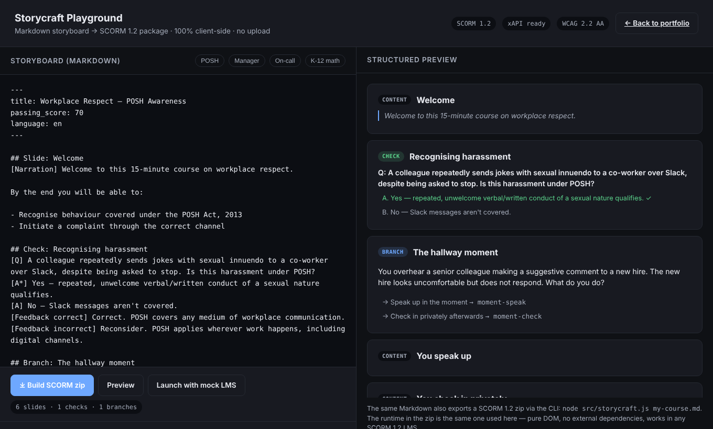
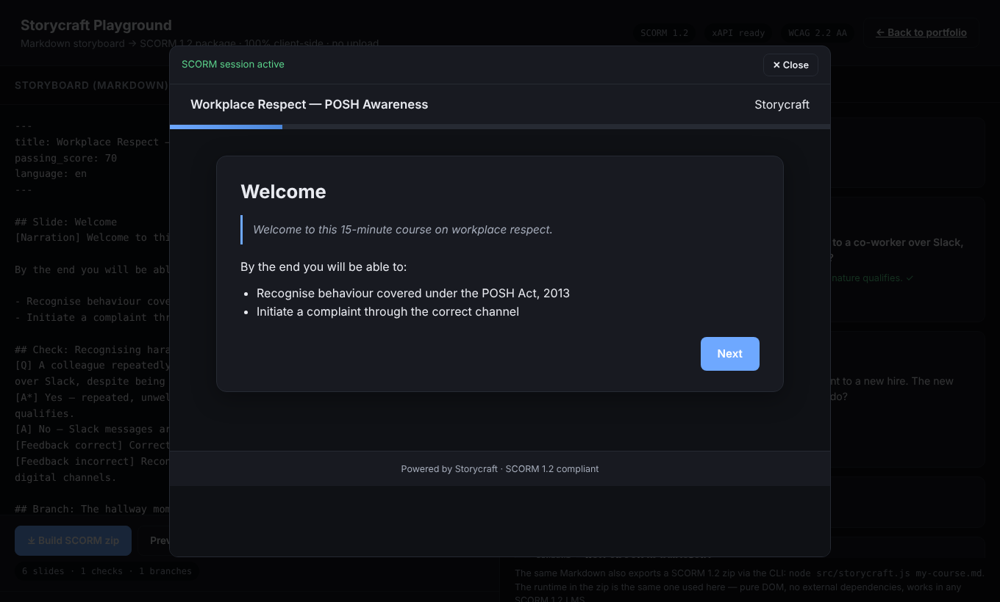

# Storycraft

[](https://github.com/parthdhanani/storycraft/actions/workflows/test.yml)
[](LICENSE)
[](https://nodejs.org)

> Markdown storyboard → SCORM 1.2 package. CLI plus an in-browser playground.

```bash
storycraft my-course.md
# → my-course.zip  (uploadable to Moodle, TalentLMS, Cornerstone, LearnUpon, …)
```

A small internal tool extracted from the Kidvento authoring pipeline and open-sourced as a teaching artifact. Not pitched as a Storyline replacement — Storyline is excellent at what it does. Storycraft fills the narrow slot where a full visual-authoring workflow is overkill: compliance modules, induction decks, and localised variants where the storyboard *is* the course and the slides exist mostly to carry text, narration, and a knowledge check.

It is also the reference build that exercises every [scorm-kit](https://github.com/parthdhanani/scorm-kit) subcommand. If you want to see what a clean SCORM 1.2 package looks like coming out of a deterministic build, run `storycraft examples/posh-awareness.md` and feed the zip into `scorm-kit lint`.

## Attribution

The Storycraft playground uses [scorm-again](https://github.com/jcputney/scorm-again) (MIT © Jonathan Putney) to power its mock LMS preview. When you click "Launch with mock LMS", scorm-again provides a spec-compliant `window.API` in the parent frame so the course runs against a real SCORM runtime — not a no-op shim.

## Why a separate tool

Most teams treat the storyboard and the published course as two artifacts. Reviewers comment on a doc, the developer rebuilds it in Storyline, and any subsequent edit becomes a two-place update. For the modules where that round-trip is the bottleneck — not the visual design — Storycraft collapses it: the storyboard is the source of truth and the SCORM package is a deterministic build artifact (same input, byte-identical zip).

| | Before | With Storycraft |
|---|---|---|
| Storyboard → first reviewable build | a half-day in the authoring tool | seconds |
| Edit a typo found in QA | re-open authoring tool, re-publish, re-zip | edit Markdown, rerun |
| Build 6 localised variants | 6 source files, manual sync | 6 Markdown files, one build script |
| Output runs in any SCORM 1.2 LMS | ✔ | ✔ — same |

It does **not** replace Storyline (or Rise, or Captivate) for visual-heavy or interaction-rich courses. It replaces the *Markdown-doc-then-rebuild* loop for the chunk of corporate modules that are essentially "slides + narration + a knowledge check + maybe a scenario."

## Quick start

```bash
git clone https://github.com/parthdhanani/storycraft
cd storycraft
node src/storycraft.js examples/posh-awareness.md
# → dist/posh-awareness.zip

node src/storycraft.js examples/posh-awareness.md --locale hi
# → dist/posh-awareness-hi.zip  (reads examples/posh-awareness.hi.md)
```

The CLI needs only Node ≥ 18 plus the standard `bash`, `find` and `zip` binaries. `npm install` isn't required to build.

Upload the zip to Moodle as a SCORM activity. It tracks completion, score, and per-question results via the SCORM 1.2 API.

## Playground



`playground/index.html` is a single self-contained page. Paste or edit Markdown, see the structured preview live, and download a SCORM zip built in the browser. The page loads two libraries from CDNs: JSZip, for building the zip, and [scorm-again](https://github.com/jcputney/scorm-again), for the mock LMS. Everything else is inlined.

```bash
python3 -m http.server -d playground 8080   # then open http://localhost:8080
```

**Launch with mock LMS** runs the course in a modal against a real SCORM 1.2 runtime, and the status bar tracks the session:



Opening the file directly (`file://`) works for editing, preview and Build. The mock-LMS session only connects when the page is served over `http://`, because browsers treat `file://` pages as opaque origins, so the course iframe can't reach `window.parent.API`.

`playground/index.html` is generated, so don't edit it by hand. Change `playground/playground.template.html`, `src/` or `runtime/`, then run:

```bash
npm run playground          # rebuild playground/index.html
npm run playground:check    # exit 1 if the committed file is stale (also run by npm test)
```

## Storyboard syntax

```markdown
---
title: Workplace Respect — POSH Awareness
duration: 15min
passing_score: 70
language: en
---

## Slide: Welcome
[Narration] Welcome to this 15-minute course on workplace respect.
Click Next to begin.

## Check: Recognising harassment
[Q] Is repeated unwelcome banter over Slack covered under POSH?
[A*] Yes — verbal/written conduct of a sexual nature qualifies regardless of medium.
[A] No — Slack isn't covered.
[Feedback correct] Right — POSH applies wherever work happens.

## Branch: The hallway moment
[Prompt] You overhear a senior colleague making a suggestive comment...
[Option: Speak up → moment-speak]
[Option: Check in privately → moment-check]
[Option: Walk away → moment-walk]

## Slide: You speak up
[Id] moment-speak
Direct intervention can be powerful — when safe.
```

Full grammar in [`src/parser.js`](src/parser.js).

## What ships in the SCORM package

```
posh-awareness.zip
├── imsmanifest.xml      SCORM 1.2 manifest (ADL CAM)
├── player.html          SCO entry point
├── player.js            runtime: navigation, scoring, SCORM/xAPI calls
├── player.css           WCAG 2.2 AA styling; dark mode; prefers-reduced-motion
├── scorm12-api.js       LMS API wrapper; no-op fallback if launched standalone
└── assets/              any images you reference in the storyboard
```

The runtime:

- **Speaks SCORM 1.2:** `cmi.core.score.raw`, `cmi.core.lesson_status`, `cmi.core.session_time`, `cmi.interactions.*` (0-indexed)
- **Speaks xAPI** (optional): set `xapi.endpoint` and `xapi.auth` in frontmatter — emits `experienced`, `answered`, `passed`/`failed` statements
- **Runs standalone:** open `player.html` directly, SCORM calls degrade to no-ops, course still completes
- **WCAG 2.2 AA:** keyboard nav, focus management on slide change, `prefers-color-scheme`, `prefers-reduced-motion`, ARIA roles on radiogroups + progress bar

## Architecture

```
storyboard.md
   │
   ▼
parser.js (AST) ──► storycraft.js ──┬──► imsmanifest.xml
                                    ├──► player.html  (course JSON injected)
                                    ├──► runtime files
                                    └──► zip
```

Runtime is **pure JS, no dependencies, no build step**. CLI is **pure Node, no `npm install`**. The whole thing is ~900 lines of JS. Runs offline on any machine with Node and `zip`.

The playground reuses the same parser, manifest generator and runtime. `build-playground.js` inlines `src/parser.js`, `src/manifest.js` and the `runtime/` files into `playground/playground.template.html`, so a browser-built zip matches a CLI-built one.

## Tests

```bash
npm ci          # dev-only: eslint
npm test        # 13 tests, node test/run.js: CLI, deterministic builds, manifest, locales, playground sync
npm run lint    # eslint .
```

All tests run offline. CI (`.github/workflows/test.yml`) runs lint on Node 22 and the tests on Node 18, 20 and 22.

## What it doesn't do (yet)

- Drag-and-drop, hotspot, dial interactions — Storyline territory
- Custom triggers/variables beyond branching and scoring
- AICC, SCORM 2004, cmi5 — only SCORM 1.2 today (cmi5 is on the roadmap)
- Multi-SCO packages — single-SCO only

## Roadmap

- `storycraft watch` for live-rebuild during authoring
- `storycraft lint` to validate a storyboard without building
- cmi5 target alongside SCORM 1.2

## Author

Built by [Parth Dhanani](https://psidex.com) — Senior Instructional Designer & SCORM Team Lead at Kidvento.

Designed for the workflow that handled 100+ K-12 SCORM packages at Kidvento and 6-language localisations at Learning Owl.
